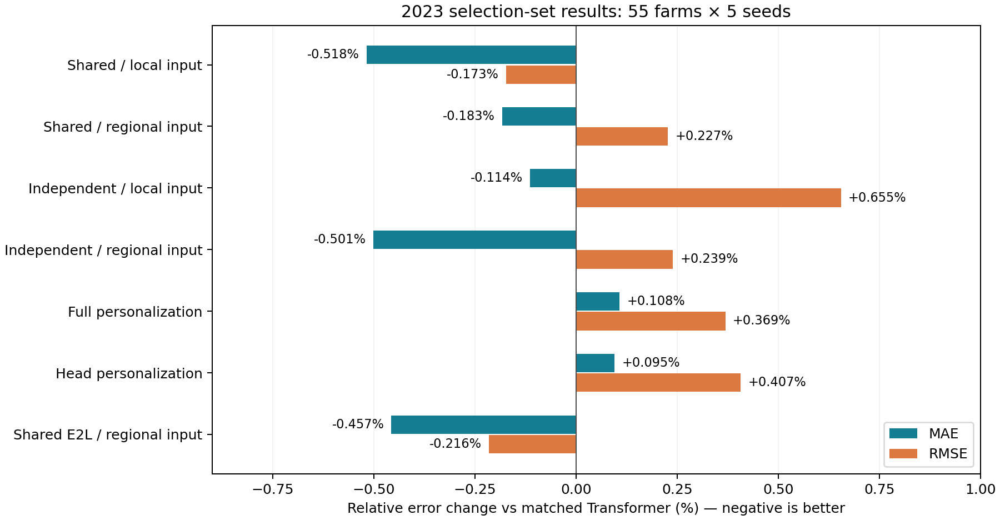

# 每日起报新协议：完整重训结果与路线审查

> **用户最新约束：编码不作为机制贡献或独立贡献。** E2L/E2C只作为架构选择与消融；此前围绕简化编码组织贡献的建议已撤回。现有内部编码对照尚不能区分与TF比较中的编码和骨干效应，需要同编码跨骨干对照。见 [编码定义、现有对照和后续定位](ENCODING_ROLE_CLARIFICATION_20261115_CN.md)。

**2571/2571项已全部完成，失败0；最终完成时间2026-11-15 19:41（北京时间）。当前原版W0/E2C以及CBH路线不支持“0–6 h全面优于Transformer”。最有希望的本模型候选是去掉柱坐标与天气非线性映射的E2L共享版本，但仍未通过高功率退化约束，也尚无独立训练或新风场迁移验证。**

本文只使用新协议结果。若以现有结果选择已见风场的预测方案，2023选模后的TF全参数微调在核心部署方案中表现最好；这不构成本模型性能优势。若必须体现本模型优势，优先验证E2L，不应继续把CBH、复杂柱坐标编码或新风场迁移写成已得到支持的主线。

导航：[完成核验](#完成核验) · [主要比较](#主要比较) · [单风场训练方式](#单风场训练方式) · [消融与机制](#消融与机制) · [时效与风场边界](#时效与风场边界) · [建议路线与贡献边界](#建议路线与贡献边界) · [数据和代码入口](#数据和代码入口)。

## 完成核验

|队列|完成数|完成时间|
|---|---:|---|
|共享调参、baseline、B0/OOF、条件机制、RM|180/180|11-15 02:57|
|55站×W0/TF×全参数/输出层×5 seeds微调|1100/1100|11-15 05:36|
|补充调参与共享对照、消融191项＋逐站独立1100项|1291/1291|11-15 19:41|

检查时有10项任务保留在繁忙的6002，6001已空闲。已停止本轮调度、确认无重复worker，迁移已有检查点并逐文件核对SHA256，恢复后完成最后10项；模型、样本、配置、种子、预算均未修改。前次17:00–19:00的预计没有覆盖这次保留任务停滞，不能继续用其解释完成状态。见 [尾部恢复记录](operations/eta_recovery_20261115/TAIL_RECOVERY.json)。

[完成审计](analysis/daily_protocol_review_20261115/COMPLETION_AUDIT.json)逐项验证2571份选中权重、2200份固定E1/E6权重、25份B0预测数组，以及spec、年份、数据指纹、冻结代码和有限指标；共核对5033个不同文件。70个完整模型组均为55站×5seeds；[独立重算检查](analysis/daily_protocol_review_20261115/INDEPENDENT_AGGREGATION_CHECK.json)与原收集器72行汇总在1e−12容差内一致。三机本轮训练进程已退出，见 [进程核验](analysis/daily_protocol_review_20261115/PROCESS_EXIT_AUDIT.json)。

共享run中的`FAIL_NO_LARGE_SCALE_PERSONALIZATION`是预定性能门槛未通过的标签，不是训练失败；`personalization_started:false`是该收集器自身未触发后续的历史字段。本轮微调已按用户授权由独立followup执行并完成，不得据此误判1100项尚未运行。

## 比较口径

- 任务0–6 h、24个15 min预测点；Pangu每天00 UTC，15 h后可用；邻站/区域功率可用至起点。2022训练，2023选超参数与检查点；固定55站，每站验证起点29647个。
- **W0**是本框架的无轨迹条件模型，默认天气编码E2C；**TF**是已调参Transformer。**BASE**使用本站历史、天气和站点信息；**R3**增加SEL物理/状态特征、近邻汇总与三环区域功率。单风场预测输出、参数共享训练、是否使用邻站输入是三个不同维度。
- E2L使用原始14天气通道与三层线性映射，保留W0其余结构及R3输入；E2N是同输入、同参数数量但含GELU的控制。E2L不是新风场迁移模型，也不是已经验证的独立单站模型。
- 指标是容量因子误差，不是MW。表中数值为55站×5seeds等权汇总，百分比为`100×(候选/参照−1)`；负数更好。改善站数比较每站完整5seed均值，不能替代逐seed原值。高功率按起点当前容量因子≥0.75定义，不是按未来目标筛选。
- [逐风场逐seed原始指标](analysis/daily_protocol_review_20261115/all_farm_seed_metrics.csv)、[关键逐seed与全55站明细](analysis/daily_protocol_review_20261115/FARM_AND_SEED_DETAILS_CN.md)、[所有配对原值](analysis/daily_protocol_review_20261115/paired_farm_seed_comparisons.csv)保留全部改善和退化。
- 2023同时用于选择和报告，尤其微调允许第0轮参与选模，相对底座的MAE收益存在选择优势。不能把这些差异直接当作独立泛化证据。描述性风场bootstrap没有处理空间依赖、多重比较或选模，不能据其宣称独立统计显著。2024尚未在本轮复评，且历史已看过，只能称探索性跨年复评。

## 主要比较

|候选|参照|ΔMAE|ΔRMSE|Δ高功率RMSE|MAE改善站数|RMSE改善站数|
|---|---|---|---|---|---|---|
|SHARED_W0_BASE|TF_BASE|-0.518%|-0.173%|+1.564%|37/55|33/55|
|W0_R3|TF_R3|-0.183%|+0.227%|+0.619%|27/55|20/55|
|INDEPENDENT_W0_BASE|INDEPENDENT_TF_BASE|-0.114%|+0.655%|+1.240%|30/55|16/55|
|INDEPENDENT_W0_R3|INDEPENDENT_TF_R3|-0.501%|+0.239%|-0.110%|40/55|18/55|
|W0_P1_FULL|TF_P1_FULL|+0.108%|+0.369%|+0.489%|16/55|12/55|
|W0_P2_HEAD|TF_P2_HEAD|+0.095%|+0.407%|+0.533%|22/55|13/55|
|ENC_neutral_E2L|TF_R3|-0.457%|-0.216%|+0.153%|42/55|33/55|

1. **原版W0共享R3没有全面赢。** MAE降低0.183%，RMSE增加0.227%，高功率RMSE增加0.619%；仅19/55站两项均改善。
2. **独立训练没有解决RMSE问题。** W0-R3相对独立TF-R3的MAE降低0.501%，40/55站改善、5个seed总体MAE都改善；但RMSE增加0.239%，只有18/55站改善，5个seed总体RMSE全部退化。275个站点×seed配对中，MAE胜185个，RMSE仅胜99个。仅本站BASE也有同样分歧，RMSE增加0.655%。
3. **微调不是W0优于TF的证据。** W0和TF都可从各自底座改善，但全参数微调后W0对TF的MAE/RMSE分别增加0.108%/0.369%。固定E1/E6比较也没有反转这点。
4. **E2L是当前最值得继续验证的本模型候选。** 相对同输入共享TF，MAE降低0.457%、RMSE降低0.216%，改善站数42/55和33/55；双指标同时改善28/55站。5个seed的MAE都好，RMSE只有3/5个好。高功率RMSE增加0.153%，超过原预定“退化≤0.1%”门槛，因此整体门槛仍未通过。
5. **E2L的比较边界很具体。** 它目前只在共享训练中有完整结果。与经过逐站选模的TF全参数微调作部署方案比较时，MAE/RMSE仍增加0.505%/0.484%；这不是同训练方式的结构归因比较，但说明它还不是当前最优部署方案。

主要方案的绝对指标如下，全部属于2023选择集：

|模型组|MAE|RMSE|高功率RMSE|参数量|
|---|---|---|---|---|
|SHARED_W0_BASE|0.089064|0.138304|0.198676|813113|
|TF_BASE|0.089528|0.138544|0.195617|174393|
|W0_R3|0.086599|0.135161|0.195159|215737|
|TF_R3|0.086758|0.134855|0.193957|182009|
|TIDE_R3|0.088063|0.135547|0.195784|535464|
|TFT_R3|0.087734|0.136697|0.197075|196039|
|M2_CBH|0.086619|0.135032|0.194381|215737|
|ENC_neutral_E2L|0.086361|0.134564|0.194254|215673|
|INDEPENDENT_W0_BASE|0.092192|0.142040|0.196705|813113|
|INDEPENDENT_TF_BASE|0.092297|0.141116|0.194296|174393|
|INDEPENDENT_W0_R3|0.088784|0.137525|0.192662|215737|
|INDEPENDENT_TF_R3|0.089232|0.137196|0.192874|182009|
|W0_P1_FULL|0.086020|0.134411|0.193484|215737|
|TF_P1_FULL|0.085928|0.133916|0.192541|182009|

同预算调参不等于同参数量：W0_BASE选择width128，TF_BASE选择64；R3的W0/TF都为64但结构参数量不同。E2L与E2N的比较才是严格同参数量非线性控制。E2L目前参数量215673，与原W0-R3的215737接近，不能未经实测称为显著轻量化。

## 单风场训练方式

|候选|参照|ΔMAE|ΔRMSE|Δ高功率RMSE|MAE改善站数|RMSE改善站数|
|---|---|---|---|---|---|---|
|INDEPENDENT_W0_BASE|SHARED_W0_BASE|+3.512%|+2.701%|-0.992%|2/55|2/55|
|INDEPENDENT_W0_R3|W0_R3|+2.524%|+1.748%|-1.279%|4/55|7/55|
|INDEPENDENT_TF_BASE|TF_BASE|+3.093%|+1.856%|-0.675%|5/55|8/55|
|INDEPENDENT_TF_R3|TF_R3|+2.852%|+1.736%|-0.559%|4/55|9/55|
|W0_P1_FULL|W0_R3|-0.668%|-0.555%|-0.858%|52/55|45/55|
|TF_P1_FULL|TF_R3|-0.957%|-0.697%|-0.730%|55/55|50/55|

在现有固定55个已见风场上，共享参数总体优于从随机初始化逐站独立训练。独立W0-R3对共享W0-R3的MAE/RMSE增加2.524%/1.748%，改善仅4/55和7/55站；TF也有相同方向。独立训练沿用对应共享调参配置，并未为每站独立搜索超参数，故不能概括为“独立训练必然差”。共享与独立的每站样本曝光轮数相同，总优化器更新数不同。

共享训练仍逐风场输出预测，符合单风场预测任务；R3需要业务上允许访问邻站/区域观测。若要求权重完全独立或只允许本站输入，就必须用对应独立/BASE结果，不能拿共享R3替代。

微调是对已在共享训练中见过的风场做个性化。W0全参数/输出层分别有104/275、118/275个单元最终选回第0轮，TF为69/275、67/275；因此选模后的改善不能与一个固定训练轮数方案直接等同。**没有目标风场留出实验，不能写新风场迁移优势。**

## 消融与机制

### 信息输入有效，但不是W0独有收益

|候选|参照|ΔMAE|ΔRMSE|Δ高功率RMSE|MAE改善站数|RMSE改善站数|
|---|---|---|---|---|---|---|
|W0_R3|SHARED_W0_BASE|-2.768%|-2.273%|-1.770%|54/55|53/55|
|TF_R3|TF_BASE|-3.095%|-2.663%|-0.848%|55/55|55/55|
|INDEPENDENT_W0_R3|INDEPENDENT_W0_BASE|-3.696%|-3.179%|-2.055%|55/55|55/55|
|INDEPENDENT_TF_R3|INDEPENDENT_TF_BASE|-3.322%|-2.777%|-0.732%|55/55|55/55|

共享W0的R3对BASE改善2.768%/2.272%，共享TF改善3.095%/2.663%；独立训练的两模型也都在55/55站双指标均改善。R3是有价值的信息扩展，不能据此把全部增益归因于W0结构。

从完整R3中移除各项的变化如下；正值表示移除后更差：

|模型|消融|ΔMAE|ΔRMSE|
|---|---|---|---|
|W0|LOCAL_SEL|+1.786%|+1.623%|
|W0|NO_SEL|+0.988%|+1.044%|
|W0|NO_NEAR|+0.063%|+0.137%|
|W0|NO_RINGS|+0.682%|+0.625%|
|W0|NO_DENSITY|+0.274%|+0.176%|
|W0|NO_DYNAMICS|+0.429%|+0.406%|
|W0|NO_STABILITY|+0.055%|+0.136%|
|W0|NO_STATE|+0.437%|+0.406%|
|TF|LOCAL_SEL|+1.673%|+1.369%|
|TF|NO_SEL|+1.260%|+1.088%|
|TF|NO_NEAR|+0.037%|+0.028%|
|TF|NO_RINGS|+0.788%|+0.772%|
|TF|NO_DENSITY|+0.252%|+0.172%|
|TF|NO_DYNAMICS|+0.227%|+0.366%|
|TF|NO_STABILITY|+0.204%|+0.140%|
|TF|NO_STATE|+0.528%|+0.295%|

LOCAL_SEL保留本站SEL并移除近邻/三环；NO_SEL移除全部22维SEL。三环区域统计、动力、运行状态有较清晰增益；近邻汇总边际增益较小。此处不能写成“逐邻站传播机制得到验证”：当前近邻输入是池化历史加几何键，非完整逐邻站独立序列。

### 更复杂的天气表示没有稳定胜出

E2L对原E2C的MAE/RMSE改善0.275%/0.442%；对同参数GELU控制E2N改善0.267%/0.456%，该对照5个seed双指标总体均改善。E2L对单层E0仅改善0.253%/0.228%，逐seed方向不一致，说明优化参数化等因素还需区分，不能直接归为物理规律。E3分组编码没有优于E2C。

E2L是仿射层的组合；它支持“当前任务中过强天气非线性未必有益”的经验假设，不支持原“柱坐标非线性编码是主要优势”的叙述。在E2L背景加入CBH后，汇总MAE/RMSE反而增加约0.206%/0.093%。

### 条件轨迹、区域记忆与滚动校正

|候选|参照|ΔMAE|ΔRMSE|Δ高功率RMSE|MAE改善站数|RMSE改善站数|
|---|---|---|---|---|---|---|
|M1_CB|W0_R3|+0.171%|+0.212%|+0.027%|16/55|15/55|
|M2_CBH|W0_R3|+0.023%|-0.096%|-0.398%|25/55|38/55|
|M2_CBH|M4H_WRONG_CBH|+0.034%|-0.051%|-0.135%|24/55|35/55|
|W0_RM|W0_R3|+0.674%|+0.544%|-0.196%|10/55|11/55|
|TF_RM|TF_R3|+0.537%|+0.127%|+0.423%|13/55|20/55|
|W0_P0_SHARED_Z1|W0_R3|+3.966%|-1.615%|-2.431%|2/55|53/55|
|TF_P0_SHARED_Z1|TF_R3|+3.513%|-1.676%|-2.259%|2/55|54/55|

CBH比CB好，不足以证明条件机制有效：它没有同时胜过无条件W0和错日期控制。RM两模型均未改善全时效双指标。Z1明显降低RMSE，却使MAE恶化约3.5%–4.0%，属于目标权衡，不是整体增益。在主指标仍为MAE时，不建议据此继续扩大LM；LM档案完成不等于LM模型完成。

### 历史与天气交互

移除天气及全部天气派生SEL后，W0/TF的MAE都恶化约19.1%、RMSE约17.4%–17.6%；把本站历史替换为重复当前功率后，MAE恶化1.250%/1.028%，RMSE恶化1.348%/0.914%。天气在此0–6 h业务协议下不可忽略。

差分交互 `(有真实历史时的天气收益)−(重复当前值时的天气收益)`：W0的MAE/RMSE为0.000336/0.001080，41/55与49/55站为正；TF为0.000255/0.000492，37/55与39/55站为正。当前功率锚点与区域观测仍保留，这是给定这些信息后的预测交互，不是因果识别，也不是W0独占现象。

## 时效与风场边界

|相对同方式TF的候选|时效|ΔMAE|ΔRMSE|MAE胜站|RMSE胜站|
|---|---|---|---|---|---|
|W0_R3|0_1h|-0.758%|-0.442%|55/55|50/55|
|W0_R3|1_3h|-0.380%|+0.033%|36/55|22/55|
|W0_R3|3_6h|+0.016%|+0.387%|20/55|16/55|
|INDEPENDENT_W0_R3|0_1h|-1.680%|-0.722%|53/55|43/55|
|INDEPENDENT_W0_R3|1_3h|-0.899%|-0.008%|47/55|25/55|
|INDEPENDENT_W0_R3|3_6h|-0.100%|+0.452%|31/55|17/55|
|ENC_neutral_E2L|0_1h|-0.701%|-0.443%|55/55|50/55|
|ENC_neutral_E2L|1_3h|-0.541%|-0.206%|44/55|33/55|
|ENC_neutral_E2L|3_6h|-0.372%|-0.198%|37/55|30/55|

原W0独立R3的最明确优势在0–1 h：MAE/RMSE改善1.680%/0.722%，53/55与43/55站改善；3–6 h RMSE反而增加0.452%。不能把0–1 h优势推广为已固定的0–6 h任务整体优势。E2L共享版本的三个时段汇总MAE/RMSE均改善，因而比原版更值得验证，但仍有seed及风场退化。

完整独立R3配对中，仅6/55站在5个seed上双指标都改善；共享E2L对TF仅3/55站达到这一更严格条件。可把这些站作为解释性案例，但它们由成绩筛出，不能成为证明总体优势的唯一评价来源。现已完成全部55站，建议直接保留全站统计和全站明细；若论文版面只能展示少数站，应按容量、地域或训练期功率特性预定抽样，并同时提供全55站附件。

## 建议路线与贡献边界

**当前决策：原版E2C-CBH、新风场迁移、以及“独立训练全面压过TF”都不宜作为已确立的主路线。** 如果只考虑本轮已见风场的预测误差，TF全参数微调是核心部署方案中的优先参照；如果必须保持本模型，优先候选为“共享参数、逐风场输出、R3输入、E2L天气映射、无CB/CBH条件”。

建议把后续工作限定为有判别力的验证，避免先铺大矩阵：

1. 冻结E2L候选与同输入TF、E2C、E2N对照，先在预先固定的时间段/新增随机种子检查RMSE与高功率表现。现有E2L是在2023消融结果中挑出的优胜项，必须明确选择偏差。正式部署比较同时保留TF个性化参照。
2. 如果硬约束是完全独立训练，则补E2L逐站独立对照；当前1100项独立矩阵只有默认E2C的W0与TF，不能把共享E2L成绩直接挪用。若需新风场迁移，必须另做训练风场完全留出的设计，本站数据预算及适应步骤对W0/TF一致。
3. 保持0–6 h主任务和MAE/RMSE/高功率指标，冻结后再做2024探索性跨年复评。不能事后只保留有利时效、风场或将主指标改成RMSE来包装Z1。

以下仅作为研究工作的组织结构，不能预设为三个独立贡献；编码不列为机制或独立创新：

|方向|当前已有证据|尚不能宣称|
|---|---|---|
|整体单风场预测框架（方法贡献待验证）|完整框架已有性能与消融结果；编码只是实现选择|编码本身为创新；核心结构已在相同编码下胜过TF；独立/迁移已赢|
|消融归因（支撑证据）|输入删除、编码替换、错日期条件、历史×天气矩阵已重训|将编码替换单列为机制贡献；信息收益只属于W0；预测交互等于因果机制|
|业务适用边界：真实可用时刻、共享/独立/个性化、55站与分时效分析|统一每日00 UTC/15 h协议，全55站5seed原值，明确0–1 h与3–6 h差异|业务协议本身等于算法创新；只展示赢的风场可证明总体优势|

以上是方法、支撑分析、适用边界三部分；不把编码列为贡献，也不强凑三个已经成立的机制点。若后续E2L仍不能在约定条件下胜过同输入Transformer，应明确否决该优势叙事。

## 数据和代码入口

- 新天气缓存：[每日Pangu数据](/shared_data_ssd3/liying/operational_pangu_daily_20261114_v1/)，训练输入：[shared data](runs/daily_protocol_restart_20261114_v1/data/)，固定风场：[COHORT](runs/daily_protocol_restart_20261114_v1/assets/COHORT.json)。Pangu为预报，ERA5为再分析，不能称为场站实测天气。
- [共享模型实现](runs/daily_protocol_restart_20261114_v1/code/model.py)、[补充天气编码/消融实现](runs/daily_ablation_restart_20261114_v1/code/model.py)、[单站与输入遮蔽数据实现](runs/daily_ablation_restart_20261114_v1/code/data.py)。
- [微调训练与第0轮选模](runs/daily_site_finetune_20261114_v1/code/train.py)、[Z1校正](runs/daily_site_finetune_20261114_v1/code/z1.py)。
- 三个冻结清单：[180](runs/daily_protocol_restart_20261114_v1/manifest.json)、[1291](runs/daily_ablation_restart_20261114_v1/manifest.json)、[1100](runs/daily_site_finetune_20261114_v1/manifest.json)。
- [独立审计/配对分析脚本](scripts/review_daily_results_20261115.py)、[本文与明细生成脚本](scripts/render_daily_review_20261115.py)。先运行审计再运行渲染，任何缺项均不会生成完整配对结论。
- [机器可读比较与描述性区间](analysis/daily_protocol_review_20261115/COMPARISONS.json)、[比较汇总](analysis/daily_protocol_review_20261115/comparison_summary.csv)、[全部70组汇总](analysis/daily_protocol_review_20261115/group_summary.csv)、[每组5seed原值](analysis/daily_protocol_review_20261115/per_seed_summary.csv)、[分时效比较](analysis/daily_protocol_review_20261115/horizon_comparisons.csv)。
- 三个原始自动报告：[共享](runs/daily_protocol_restart_20261114_v1/analysis/RESULTS_CN.md)、[消融/独立](runs/daily_ablation_restart_20261114_v1/analysis/RESULTS_CN.md)、[个性化](runs/daily_site_finetune_20261114_v1/analysis/RESULTS_CN.md)。这些报告中的自动门槛标签应结合本文的选模与配对边界解释。

本次已完成当前2571项重训的检查、补齐和分析；未启动额外科学实验。2024复评、条件性LM模型和目标风场留出迁移不属于已完成的2571项。
