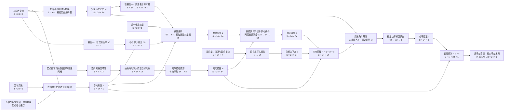

# 框架说明：模块功能、具体设计与输入输出张量

整理日期：2026-10-18。本文独立描述模型的结构、运算和数据流，不要求读者了解实验代号、配置选项或方案探索过程。

核心计算是：**先由历史预测器产生参考轨迹，再由另一套网络结合历史表示、参考轨迹和未来天气预报产生修正，最后把参考与修正相加。**历史预测器在训练修正网络时保持参数不变，因此称为“冻结的历史参考预测器”。未来天气采用预测起点已经获得的数值天气预报，简称 NWP。

$$
b=B_0(H,H_{agg},\phi,\xi),\qquad
\hat y=b+c,\qquad
c=C_\theta(W^+,M,b,\Delta b,\Gamma).
$$

这里 `B0` 表示历史参考预测器，`C_θ` 表示修正网络；`b` 为参考预测，`c` 为修正，`ŷ` 为最终预测。

模型的三个关键设计可以直接表述如下：

| 需要说明的设计 | 实际采用的做法 | 在网络中的位置 |
| --- | --- | --- |
| 修正网络怎样连接 | 天气特征与参考条件拼接后，经两层前馈网络产生特征调整；调整结果与原天气特征、目标上下文相加，再结合完整历史记忆解码为功率修正；修正最后与参考预测相加 | 天气表示和条件构造之后，最终输出之前；见第 9–11 节 |
| 参考条件包含什么 | 每个未来步使用 **64 维历史摘要 + 1 维参考值 + 1 维参考邻步变化 + 1 维归一化提前量**，合计 67 维，再编码为 64 维 | 历史编码器和参考预测器之后，天气特征调整网络之前；见第 8 节 |
| 历史摘要如何获得 | 从历史编码器输出的 24 个上下文化向量中，取最后一个 64 维向量，复制到 24 个未来步；同时保留完整历史序列供解码器使用 | 独立历史编码器之后发生分支，一路去条件编码，一路去历史条件解码；见第 5 节 |

## 1. 阅读约定与张量形状

本文统一使用**逻辑张量布局**：批次、场站、时间、通道。张量是按这些轴排列的数值数组；“形状”说明每个轴有多少个元素。本文展示的是方法中的逻辑形状，实际存储可以转置轴或省略末尾单通道轴。已确认的维度使用具体数值，资料中未确定的基准内部宽度使用符号；来源和范围见第 17 节。

| 符号 | 含义 | 当前值/约定 |
| --- | --- | --- |
| `B` | 预测起点样本数 | 可变 |
| `N` | 风场数 | 56 |
| `S` | 为说明共享场站网络而展平的样本轴 | `S = B × N` |
| `L` | 历史步数 | 24 |
| `K` | 未来预测步数 | 24 |
| `Δt` | 时间步长 | 15 min = 0.25 h |
| `T` | 最大预测提前量 | 6 h |
| `d` | 修正网络隐藏维度 | 64 |
| `M_w` | 实际使用的逐小时 NWP 节点数 | 7 |
| `C_w` | 气象通道数 | 14 |
| `G` | 将空间网格展平后的网格点数 | 依气象数据网格而定，本文不指定 |

形状示例：`[B,N,24,64] ↔ [S,24,64]`。除明确写出全风场形状的地方，模块表以 `[S,…]` 为主。功率容量因子序列统一保留单通道轴 `[S,24,1]`；实现中也可能是 `[S,24]`。

时间范围：历史时刻为 `t−5.75h,…,t`，共 24 个观测点；未来为 `t+0.25h,…,t+6h`。**24 个历史步不等于 24 小时；首尾观测点之间相差 5.75 小时。**

后文使用的标准运算名称含义如下：

| 名称 | 在本文中的具体含义 |
| --- | --- |
| 线性投影 `Linear` | 对最后一个特征轴做可学习的仿射变换；例如每步 2 个数映射为 64 维向量，时间步数不变 |
| 拼接 `concat` | 把多个向量在特征轴上接起来；例如 `64+1+1+1=67` |
| 广播 | 同一向量在多个场站或时间位置共享使用；不引入一套新的参数 |
| 时间卷积网络 TCN | 沿时间轴提取局部及多尺度时序特征的网络；基准的两个历史分支使用因果卷积 |
| 因果卷积/因果掩码 | 限制一个位置只能读取该位置及更早位置；具体在哪些模块使用，见对应模块说明 |
| Transformer 编码器 | 通过自注意力，让每个历史位置结合其他历史位置的信息，生成上下文化表示 |
| Transformer 解码器 | 先建模未来特征序列内部关系，再用交叉注意力读取另一条历史表示序列 |
| 层归一化 `LayerNorm` | 按每个位置的特征维进行归一化；前置层归一化表示在注意力或前馈子层之前归一化 |
| ReLU、GELU | 标准非线性激活函数；前者用于 Transformer 的前馈子层，后者用于条件编码、天气特征调整和标量读出 |
| 丢弃率 `dropout` | 训练时随机屏蔽部分特征的比例；评估时关闭 |

模型内“历史预测器”“历史编码器”“条件编码器”“天气特征调整网络”和“历史条件解码器”均是不同位置的模块；不能仅因为都含有编码或注意力操作就视为同一个模块。

## 2. 外部输入与输出

| 输入/输出 | 逻辑张量形状 | 含义与使用位置 |
| --- | --- | --- |
| 本站历史 `H` | `[B,N,24,1]` | 历史容量因子；进入冻结基准和独立历史编码器 |
| 当前功率 `p0` | `[B,N,1]` | `H` 的最后一个观测值；用于基准读出和首步参考差分 |
| 区域历史 `H_agg` | `[B,24,1]` | 容量加权区域容量因子；仅进入冻结基准的区域分支 |
| 起点可用 NWP `W_grid` | `[B,M_w,G,14]` | 此处为统一后的逻辑布局；若保留二维空间，可写为 `[B,M_w,H_g,W_g,14]` |
| NWP 有效时间偏移 `ν` | `[B,M_w]` | 各天气节点相对预测起点的实际时间偏移，用于时间插值 |
| 场站静态信息 `ξ` | 逻辑上 `[N,3]` | 纬度、经度、装机容量；实际归一化和嵌入按分支分别处理 |
| 起点相位 `φ` | `[B]` | 取值 `0,1,2,3`，对应每小时 0、15、30、45 分钟 |
| 预测提前量 `ℓ` | `[K]` | `0.25,0.50,…,6.00` 小时 |
| 训练目标 `y` | `[B,N,24,1]` | 未来真实容量因子，仅用于损失，不进入预测前向 |
| 场站预测 `ŷ` | `[B,N,24,1]` | 最终容量因子预测 |
| 场站 MW 预测 `P̂` | `[B,N,24,1]` | `C_i × ŷ_i`，容量单位为 MW 时输出为 MW |
| 区域 MW 预测 `P̂_agg` | `[B,24,1]` | 各场站 MW 预测求和 |

区域历史定义为：

$$
p_{agg}(u)=\frac{\sum_i C_i p_i(u)}{\sum_i C_i},\qquad p_i(u)=P_i(u)/C_i.
$$

天气分支使用 7 个逐小时天气节点，每个节点有 14 个气象通道。本文不指定资料中未确认的网格大小、气象变量名称和原始数据轴顺序。

## 3. 模块与张量流总览

| 编号 | 实际功能模块 | 输入张量 | 输出张量 | 训练修正网络时的状态 |
| --- | --- | --- | --- | --- |
| A | 历史参考预测器 `B0` | `H [S,24,1]`、区域历史、静态信息、相位及提前量 | `b [S,24,1]` | 参数冻结，保持评估模式 |
| B1 | 历史功率/相对时间拼接与投影 | `H [S,24,1]` + 时间 `[S,24,1]` | `E_H [S,24,64]` | 投影可训练 |
| B2 | 独立历史 Transformer 编码器 | `E_H [S,24,64]` | `M [S,24,64]` | 可训练 |
| B3 | 末位上下文化摘要 | `M [S,24,64]` | `m [S,64]`，广播后 `m_K [S,24,64]` | 读出无新参数 |
| C1 | NWP 空间采样 | `W_grid [B,7,G,14]`、场站位置/四点权重 | `z [B,N,7,14] → [S,7,14]` | 固定采样 |
| C2 | NWP 有效时间对齐 | `z [S,7,14]`、`ν`、目标提前量 | `z_bar [S,24,14]` | 固定插值 |
| C3 | 天气特征投影 | `z_bar [S,24,14]` | `w [S,24,64]` | 可训练 |
| D1 | 目标上下文构造 | 提前量、纬度、经度、容量、相位 | `Γ [S,24,7]` | 确定性特征构造 |
| D2 | 目标上下文投影 | `Γ [S,24,7]` | `q [S,24,64]` | 可训练 |
| E1 | 参考轨迹邻步差分 | `b [S,24,1]`、`p0 [S,1]` | `Δb [S,24,1]` | 无参数 |
| E2 | 条件输入拼接 | `m_K [S,24,64]`、`b`、`Δb`、归一化提前量 | `u [S,24,67]` | 无参数 |
| E3 | 条件编码与逐提前量偏置 | `u [S,24,67]`、`e [24,64]` | `s [S,24,64]` | 可训练 |
| F | 条件控制的天气特征调整网络 | `concat(w,s) [S,24,128]` | `a [S,24,64]` | 可训练 |
| G | 未来特征融合 | `q,w,a`，均 `[S,24,64]` | `F_future [S,24,64]` | 加法无新参数 |
| H | 读取完整历史的 Transformer 解码器 | 未来特征 `F_future [S,24,64]`、历史记忆 `M [S,24,64]` | `X [S,24,64]` | 可训练 |
| I | 标量功率修正头 | `X [S,24,64]` | `c [S,24,1]` | 可训练 |
| J | 最终参考相加 | `b,c`，均 `[S,24,1]` | `ŷ [S,24,1] → [B,N,24,1]` | 加法无新参数 |
| K | 容量还原与区域汇总 | `ŷ [B,N,24,1]`、容量 `[N]` | 场站 MW、区域 MW | 无参数 |

## 4. A：冻结历史参考预测器的内部模块

功能：仅依据可用历史、场站与目标时间信息，产生一个可解释的预测参照 `b`。它不读取未来 NWP，也不读取修正侧的独立历史记忆 `M`。

位置：位于历史输入之后，作为与修正网络并列的参考分支。该分支先独立训练；训练修正网络时，它继续计算参考轨迹，但自身参数不更新。

基准内部通道宽度在本次可访问的记录中不完整，因此以下采用 `D_s,D_a,D_t,D_r,D_f` 等符号，不将修正分支的 `d=64` 套用于这些未确认宽度。

| 子模块 | 输入 | 输出 | 功能 |
| --- | --- | --- | --- |
| A1 场站嵌入 | 场站静态信息 | 与本站历史投影可相加的嵌入，逻辑为 `[S,D_s]` | 提供场站差异；跨历史步广播 |
| A2 本站历史投影与因果时间卷积 | `H [S,24,1]` + 场站嵌入 | `U [S,24,D_s]` | 编码本站历史；3 个因果残差块，膨胀率 `1,2,4` |
| A3 区域历史投影与因果时间卷积 | `H_agg [B,24,1]` | 区域时序表示，末位状态 `g [B,D_a]` | 与本站分支使用不同参数；3 个因果残差块，膨胀率 `1,2,4` |
| A4 基准目标嵌入 | 基准专用 5 维提前量特征、可学习相位嵌入、场站嵌入 | `V [S,24,D_t]` | 给每个未来时刻构造历史读取查询 |
| A5 相对时间交叉注意力 | 目标查询 `V`、本站历史 `U`、目标/历史时间间隔 | `R [S,24,D_r]` | 每个未来目标读取历史；不同注意力头分别学习相对时间偏置，并使用残差连接和归一化 |
| A6 表示拼接融合 | `R`、广播后的 `g`、`V` | 融合表示 `[S,24,D_f]` | 拼接前宽度为 `D_r + D_a + D_t`；融合后的具体宽度待源码确认 |
| A7 未来轨迹残差卷积与标量更新头 | 融合表示 | `δ [S,24,1]` | 3 个未来序列时间残差卷积块；在序列两端对称填充，不是因果递推 |
| A8 当前水平锚定读出 | `δ [S,24,1]`、`p0 [S,1]` | `b [S,24,1]` | 在内部读出坐标中叠加更新，得到历史参考 |

三个历史因果卷积块依次以 `1、2、4` 的间隔取样来扩大时间感受范围；同一位置不读取更晚的历史位置。区域分支取编码后的末位状态，复制到各场站、各未来步后参加融合。未来轨迹卷积则作用于已经构造好的未来特征序列，不需要按时间逐步递推输出。

表中为语义上的输入输出形状；时间卷积实际存储时可以使用 `[S,D,L]`，而不是本文统一书写的 `[S,L,D]`。

基准的 5 维提前量特征为：

$$
[\ell/T,\ \sin(\pi\ell/T),\ \cos(\pi\ell/T),\ \sin(2\pi\ell/T),\ \cos(2\pi\ell/T)].
$$

基准读出：

$$
b_k=\operatorname{softplus}\left(\operatorname{softplus}^{-1}(\max(p_0,10^{-4}))+\delta_k\right).
$$

其中 `softplus(x)=ln(1+exp(x))`，把内部数值映射为正值；其逆函数先把当前容量因子变换到可叠加更新的内部坐标。该模块先将当前值下限设为 `10⁻⁴`，再变换、加上每步更新 `δ_k`，最后映射回容量因子。当 `δ_k=0` 时，参考输出等于经过下限处理的当前值；这一读出保证参考为正，但不限制其上限为 1。

`g` 在场站与未来时间轴上广播；这表示区域历史信息被共享使用，并不表示场站之间存在额外图消息传递。

基准输出有两条路径：`b → 条件构造`，以及 `b → 最终 ŷ=b+c`。训练修正网络时，基准保持参数固定和评估模式，关闭训练时的随机丢弃；不同输入仍然产生不同 `b`。

## 5. B：独立历史表示与摘要

位置：这是修正网络的历史输入分支，与冻结参考预测器内部的历史卷积网络相互独立。它从本站历史出发，输出完整历史表示，再分出摘要路径和完整记忆路径。

### B1. 每个历史时刻的两维输入

每个历史时刻拼接容量因子和归一化相对时间：

$$
x^H_j=[h_j;\tau_j/T],\qquad \tau_j=(j-L)\Delta t.
$$

这里 `j=1,…,L`，因此相对时间从 `−5.75h` 到 `0h`，均相对于预测起点计算。

```text
H                       [S,24,1]
relative_time / T       [S,24,1]
concat                  [S,24,2]
Linear(2 → 64)          [S,24,64]
```

### B2. 历史 Transformer 编码器

位置：接收 B1 的 64 维投影，输出 B3 所需的历史序列表示。每层先通过自注意力让每个位置读取整个历史窗口，再通过逐位置的前馈网络更新特征，子层配有残差连接。

具体结构为两层、四个注意力头、隐藏维度 64、前馈网络中间宽度 128、前置层归一化；前馈网络激活为 ReLU，丢弃率为 0.05。全部历史在预测起点可用，因此不屏蔽历史窗口内较晚的位置。

```text
Encoder_H([S,24,64]) → M [S,24,64]
```

`M` 与基准内部的本站时间卷积表示 `U` 是两套不同表示，其编码器不共享参数。

### B3. 取最后一个历史表示作为摘要

位置：在完整历史编码结束之后、参考条件拼接之前。先取 `M` 时间轴的最后一个向量，得到 64 维摘要，再把同一个摘要提供给 24 个未来步。

```text
m   = M[:, -1, :]                      # [S,64]
m_K = m[:, None, :].expand(-1,24,-1)    # [S,24,64]
```

最后一个向量已经通过前面的自注意力读取完整历史上下文，因此不等于原始最后一个功率值，也不是把 24 个向量求平均。选取和广播均不引入新参数，也不改变原始 `M`。

两条历史路径分别为：

- `m_K → 条件编码器`：紧凑摘要参与轨迹条件构造。
- `M → 历史条件解码器的记忆输入`：保留所有历史位置的表示，供每个未来目标通过交叉注意力读取。

## 6. C：未来天气表示

位置：在数值天气预报输入之后、天气特征调整和未来特征融合之前。依次完成“空间上对应到场站 → 时间上对应到预测目标 → 映射到 64 维特征空间”。

### C1. 空间采样

对每个场站，使用周围四个网格点的固定双线性权重：

$$
z_{i,m}=\sum_{g\in\mathcal N_i}\omega_{i,g}W_m(g),\quad |\mathcal N_i|=4,\quad \sum_g\omega_{i,g}=1.
$$

```text
NWP 网格                  [B,7,G,14]
按场站位置取四邻点并加权    [B,N,7,14]
逻辑展平                  [S,7,14]
```

### C2. 有效时间对齐

根据每个天气节点的预报有效时刻相对预测起点的偏移，将 7 个节点对齐到 24 个预测目标：

$$
\alpha_k=(\ell_k-\nu_m)/(\nu_{m+1}-\nu_m),\qquad
\bar z_k=(1-\alpha_k)z_m+\alpha_kz_{m+1}.
$$

目标落在节点区间外时保持最近端点值。`ν` 按同一个预测起点广播至各场站，不默认每个样本的有效时间偏移完全一致。

```text
z [S,7,14] + 天气有效时间偏移 + 目标提前量 → z_bar [S,24,14]
```

这一步得到目标对齐的预测协变量，不表示恢复了真实的 15 分钟天气观测。

### C3. 天气特征投影

位置：时间对齐之后。每个未来目标已经对应一个 14 维天气向量，这一步把它变成 64 维特征。有效前向形式为逐目标的仿射映射：

$$
w_k=A_W\bar z_k+d_W,\qquad [S,24,14]\rightarrow[S,24,64].
$$

底层由多个投影组合实现，并将每个目标可访问的天气位置限制为对齐后的单个位置。只有一个可选位置时，注意力权重归一化后固定为 1，不会发生“根据目标特征在多个天气时刻之间选择”的操作，因此整体可等效为上述仿射映射。有效 `14→64` 描述输入输出关系，不要求底层恰好只有一个线性层。

`w` 分成两路：进入第 9 节的条件天气特征调整网络，以及直接进入第 10 节的未来特征加法 `F_future=q+w+a`。

## 7. D：目标上下文

位置：与天气表示分支并列，由提前量、场站信息和起点相位直接构造；其输出在天气特征调整之后参加未来特征融合。它告诉模型“预测哪个场站、距离起点多远、起点位于小时内哪个时间槽”。

每个场站、每个目标步构造 7 维向量：

$$
\gamma_{i,k}=[\ell_k/T;\sin(2\pi\ell_k/24);\cos(2\pi\ell_k/24);\tilde\lambda_i;\tilde\eta_i;C_i/\bar C;\phi/3].
$$

| 分量 | 维数 | 含义 |
| --- | --- | --- |
| `ℓ/T` | 1 | 归一化提前量 |
| `sin(2πℓ/24), cos(2πℓ/24)` | 2 | 提前量的周期编码，`ℓ` 单位为小时 |
| 标准化纬度、经度 | 2 | 场站位置 |
| `C_i/平均装机容量` | 1 | 相对装机容量 |
| `φ/3` | 1 | 起报在一小时内的 15 分钟相位 |

```text
Γ [S,24,7] → Linear(7 → 64) → q [S,24,64]
```

`q` 直接进入未来特征融合，不来自天气、不经过天气特征调整网络。它与基准内部的目标嵌入 `V` 是不同模块；这里的正余弦不是绝对钟点，起点相位也不是季节。

## 8. E：参考条件构造

位置：接收第 4 节的参考轨迹、第 5 节的历史摘要，以及目标提前量；编码结果提供给第 9 节的天气特征调整网络。该模块用具体数值描述“这段历史背景下，参考预测目前处于什么水平、如何变化、要预测多远”。

### E1. 参考轨迹差分

$$
\Delta b_1=b_1-p_0,\qquad \Delta b_k=b_k-b_{k-1}\;(k>1).
$$

```text
b                       [S,24,1]
p0                      [S,1]
first = b[:, :1, :] - p0[:, None, :]     # [S,1,1]
rest  = b[:, 1:, :] - b[:, :-1, :]       # [S,23,1]
Δb = cat([first, rest], dim=1)           # [S,24,1]
```

这里未除以 `Δt`，所以 `Δb` 是邻步变化，不是时间导数。它也不同于基准内部更新 `δ` 和最终修正 `c`。

### E2. 67 维条件输入

对每个未来步拼接以下四项：历史摘要提供过去的上下文，参考值提供预计功率水平，邻步差分提供参考轨迹的局部变化，归一化提前量提供该步的位置。

$$
u_k=[m;b_k;\Delta b_k;\ell_k/T].
$$

```text
历史摘要 m_K             [S,24,64]
参考水平 b               [S,24,1]
参考变化 Δb              [S,24,1]
归一化提前量             [S,24,1]
沿最后一维拼接 u         [S,24,67]       # 64+1+1+1
```

### E3. 条件编码器与逐提前量可学习偏置

位置：在 E2 的 67 维向量拼接之后、与天气特征拼接之前。先用线性层降至 64 维，经过非线性和层归一化，再加入该未来步专用的 64 维偏置。

$$
s_k=\operatorname{LN}(\operatorname{GELU}(A_su_k+d_s))+e_k.
$$

```text
u                        [S,24,67]
Linear(67 → 64)          [S,24,64]
GELU                     [S,24,64]
LayerNorm(64)            [S,24,64]
+ e[None, :, :]          [S,24,64]       # e 的参数形状为 [24,64]
s                        [S,24,64]
```

`e_k` 按未来步索引、跨场站和样本共享；不是为每个场站单独分配一套逐步偏置。条件编码按目标步执行，整个条件序列为 `s`。

## 9. F：条件控制的天气特征调整网络

位置：在天气投影 C3 和条件编码 E3 之后、未来特征相加 G 之前。功能是对每个未来步拼接天气特征 `w` 与条件 `s`，使用两层前馈网络生成隐特征调整 `a`。

$$
a_k=A_2\operatorname{GELU}(A_1[w_k;s_k]+d_1)+d_2.
$$

```text
w                        [S,24,64]
s                        [S,24,64]
concat(w,s)              [S,24,128]
Linear(128 → 64)          [S,24,64]
GELU                     [S,24,64]
Linear(64 → 64)           [S,24,64]
a                        [S,24,64]
```

这是“128 维输入 → 64 维隐藏层 → 64 维输出”的两层前馈网络，中间采用 GELU 激活；没有把天气向量与条件向量逐元素相乘的显式门控。末层权重和偏置零初始化。`a` 是 64 维特征增量，不是气象变量改变量，也不是标量功率修正。

## 10. G–I：未来特征融合、历史条件解码与功率修正

位置：在天气特征调整之后、最终参考相加之前。框架图为便于概览，把这三个连续模块合并为“历史感知读出”；具体计算必须拆成下面三步。它们共同接收 `a`、`w`、`q`、`M` 四类信息，先把前三项相加，再用完整历史记忆进行解码，最后映射为标量修正。

### G. 未来特征融合

$$
F_{future}=q+w+a.
$$

位置：紧接天气特征调整网络。三项形状均为 `[S,24,64]`，执行逐元素加法，输出仍为 `[S,24,64]`。这里不拼接，不把 `M` 加进去，也不把 `b` 直接加到 64 维特征中。

### H. 完整历史条件解码

位置：接收 G 生成的未来特征序列；同时从第 5 节的历史编码器直接接收完整 `M`。未来特征用于发出查询，历史记忆提供可读取的内容，输出每个未来目标的 64 维表示。

$$
X=\operatorname{Decoder}(\mathrm{tgt}=F_{future},\mathrm{memory}=M).
$$

```text
未来输入 F_future         [S,24,64]       # 未来目标时间轴 K
历史记忆 M                [S,24,64]       # 历史时间轴 L
Transformer 解码器        2 层 / 4 个注意力头 / 前馈宽度 128 / 前置层归一化
X                        [S,24,64]
```

每层依次完成未来特征之间的自注意力、对完整历史记忆的交叉注意力以及逐位置前馈运算，各子层使用前置层归一化和残差连接；前馈网络使用 ReLU，丢弃率为 0.05。未来协变量在起点已可用，因此未来自注意力不使用因果掩码，也不输入未来真实功率。

在注意力中，“查询”表示当前目标要读取什么，“键”用于计算该目标与各个候选位置的匹配程度，“值”是按匹配权重加权汇总的内容。交叉注意力的查询来自未来序列，键和值来自历史序列。

按标准四头注意力的逻辑拆分，每头维度为 `64/4=16`：

| 注意力位置 | 查询 | 键 / 值 | 逻辑注意力权重形状 |
| --- | --- | --- | --- |
| 历史编码器的自注意力 | 历史 `[S,4,L,16]` | 历史 `[S,4,L,16]` | `[S,4,L,L]` |
| 解码器的未来自注意力 | 未来 `[S,4,K,16]` | 未来 `[S,4,K,16]` | `[S,4,K,K]` |
| 解码器读取历史的交叉注意力 | 未来 `[S,4,K,16]` | 历史 `[S,4,L,16]` | `[S,4,K,L]` |

这些是数学上的形状，不代表实现一定显式保存或返回注意力权重。虽然 `K=L=24`，但未来时间轴和历史时间轴的含义仍不同。

### I. 功率修正读出

位置：在历史条件解码器之后。对每个未来目标的 64 维表示独立使用两层前馈网络，先降到 32 维，经 GELU 后映射为 1 个修正值。

```text
X                        [S,24,64]
Linear(64 → 32)          [S,24,32]
GELU                     [S,24,32]
Linear(32 → 1)           [S,24,1]
c                        [S,24,1]
```

末层权重和偏置零初始化。`c` 的单位是容量因子，允许为正或负；它才是最终输出空间的功率修正。

## 11. J–K：最终预测与区域汇总

位置：模型输出端。参考轨迹沿独立路径抵达此处，与修正逐步相加；如需 MW 单位，再乘装机容量并汇总场站。

```text
b + c                    [S,24,1] + [S,24,1]
ŷ                        [S,24,1]
恢复批次和场站轴          [B,N,24,1]
P̂ = ŷ × C               [B,N,24,1]
P̂_agg = sum(P̂, dim=N)   [B,24,1]
```

最终预测为原始 `b+c`，不额外使用 softplus、sigmoid 或截断。基准内部的 softplus 不会约束最终预测范围。区域 MW 是容量加权后的求和，不是对容量因子直接求和。

## 12. 整体张量流程图



如果阅读器不渲染 Mermaid，可按下列主线阅读：

```text
历史参考：本站历史 + 区域历史 + 场站/相位/提前量 → 历史预测器 → b
历史表示：本站历史 → 独立历史编码器 → 完整记忆 M → 取最后一个向量并广播 → m_K
参考条件：m_K + 参考值 b + 参考邻步差 Δb + 归一化提前量 → 拼接并编码 → s
天气表示：数值天气预报 → 空间采样 → 有效时间对齐 → 特征投影 → w
条件调整：拼接(w,s) → 两层前馈网络 → a
目标上下文：提前量/场站/起点相位 → 7 维向量 → 线性投影 → q
历史解码：q+w+a → 未来特征 F_future；以 F_future 查询完整记忆 M → X
功率输出：X → 标量读出 → c；最终预测 ŷ=b+c
```

## 13. 按执行顺序核对张量

以下是上述模块的数学计算清单，函数描述均对应前文已展开的具体运算，不依赖代码中的类名或配置开关。为简洁起见，省略批次和场站展平的重复书写。

```text
1. 历史输入：
   H                                     [S,24,1]
   p0 = H 的最后一个观测                  [S,1]

2. 参考预测（第 4 节）：
   b = 历史参考预测器(H, H_agg, 场站, 相位, 提前量)
                                         [S,24,1]

3. 完整历史表示（第 5 节 B1–B2）：
   x_H = 拼接(H, 相对历史时间/T)           [S,24,2]
   E_H = Linear(2→64)(x_H)                [S,24,64]
   M = 两层历史 Transformer 编码器(E_H)  [S,24,64]

4. 摘要（第 5 节 B3）：
   m = M[:, -1, :]                       [S,64]
   m_K = 将 m 广播到 24 个未来步           [S,24,64]

5. 天气表示（第 6 节）：
   z = 将天气网格空间采样到场站             [S,7,14]
   z_bar = 根据有效时间插值至未来目标时刻    [S,24,14]
   w = 天气特征投影(z_bar)                [S,24,64]

6. 目标上下文（第 7 节）：
   Γ = 构造提前量/经纬度/容量/相位特征       [S,24,7]
   q = Linear(7→64)(Γ)                   [S,24,64]

7. 参考差分（第 8 节 E1）：
   Δb 的第一步 = b 的第一步 - p0
   Δb 的其余步 = 相邻两个参考值相减          [S,24,1]

8. 参考条件（第 8 节 E2–E3）：
   u = 拼接(m_K, b, Δb, 提前量/T)         [S,24,67]
   s = LayerNorm(GELU(Linear(67→64)(u)))
       + 逐提前量偏置 e                    [S,24,64]

9. 条件控制的天气特征调整（第 9 节）：
   v = 拼接(w,s)                         [S,24,128]
   a = Linear(64→64)(GELU(Linear(128→64)(v)))
                                         [S,24,64]

10. 未来特征融合（第 10 节 G）：
    F_future = q+w+a                     [S,24,64]

11. 历史条件解码与功率读出（第 10 节 H–I）：
    X = 两层 Transformer 解码器(未来输入=F_future, 历史记忆=M)
                                         [S,24,64]
    c = Linear(32→1)(GELU(Linear(64→32)(X)))
                                         [S,24,1]

12. 最终预测与容量还原（第 11 节）：
    ŷ = b+c，恢复批次和场站轴              [B,N,24,1]
    场站 MW = ŷ × 各场站装机容量           [B,N,24,1]
    区域 MW = 对场站 MW 沿场站轴求和        [B,24,1]
```

## 14. 训练与梯度流

| 阶段 | 可训练部分 | 监督输出 | 损失 |
| --- | --- | --- | --- |
| 第一阶段：训练参考预测器 | 历史参考预测器 `B0` | `b [B,N,K,1]` | 等权场站/提前量平均绝对误差：`mean(abs(b-y))` |
| 第二阶段：固定参考，训练修正网络 | 独立历史编码器、天气投影、上下文投影、条件编码器、天气特征调整网络、历史条件解码器、功率修正读出 | `ŷ=b+c [B,N,K,1]` | `mean(abs(b+c-y))`；参考预测器参数冻结，保持评估模式 |

第二阶段中，固定参考下的最终输出平均绝对误差等价于拟合残差 `y−b`；模型前向仍显式保留 `b+c`。

历史编码器可以经摘要路径和完整记忆路径接收梯度；天气投影可经特征调整路径和直接天气路径接收梯度。这是在网络结构上的梯度通道说明，不代表零初始化的第一步各路径梯度都一定非零。

天气特征调整网络的末层、标量功率修正读出的末层，以及第 6 节 C3 中多次天气投影的最后输出投影，采用零初始化。特别是功率修正读出末层为零使初始 `c=0`，因此初始 `ŷ=b`。

训练使用 BF16 混合精度，以 float32 计算平均绝对误差；优化器为 AdamW，学习率 `2e-4`、权重衰减 `1e-4`、余弦学习率调度、梯度范数裁剪阈值 1.0，最多 80 轮，验证指标连续 10 轮未改善时早停。区域 MW 用于汇总评估，不另加区域预测损失。

## 15. 图中的简称对应哪些具体运算

图中英文仅作查找标签，具体结构以前文中文说明为准。名称相同的一个绘图区域可以包含多个计算步骤，尤其不能把“历史感知读出”误认为一层网络。

| 中文含义（图中标签） | 本文模块与位置 | 具体运算及信息流 |
| --- | --- | --- |
| 历史观测（Historical evidence） | 输入端 `H,H_agg` | 本站历史送入两个独立分支；区域历史仅送入参考预测器 |
| 历史参考预测（History-based reference） | 第 4 节 A1–A8 | 两路历史卷积、目标时间查询、特征融合和轨迹读出；输出 `b` 分别去条件构造和最终加法 |
| 历史表示（Historical context） | 第 5 节 B1–B3 | 编码本站历史得到完整 `M`，取其最后一个向量为摘要 `m`，分别送往解码器和条件编码器 |
| 未来天气及其表示（Future weather / Weather features） | 第 6 节 C1–C3 | 空间采样、有效时间插值、14→64 投影；输出 `w` 去调整网络和未来特征加法 |
| 目标上下文（Target context） | 第 7 节 D1–D2 | 7 维时间/场站信息投影为 `q`，直接进入未来特征加法 |
| 参考条件（Reference condition） | 第 8 节 E1–E3 | 拼接历史摘要、参考值、参考邻步差和提前量；67→64 编码后加逐步偏置，输出 `s` |
| 条件天气特征调整（Weather feature adaptation / Conditioned adjustment） | 第 9 节 F | 拼接 `[w,s]`，经 128→64→64 前馈网络产生特征增量 `a` |
| 天气直接路径（Direct weather features） | C3 → G | 原始 `w` 绕过调整网络，直接参与未来特征构造 |
| 历史参与的融合与读出（History-aware readout） | 第 10 节 G、H、I | 先 `q+w+a`，再查询完整 `M`，最后经 64→32→1 标量读出得到 `c` |
| 功率修正（Power correction） | I 的输出、J 的输入 | 标量序列 `c [S,24,1]`，送往最终功率空间加法 |
| 最终功率预测（Wind-power forecast） | 第 11 节 J，必要时 K | `b+c` 得到容量因子；MW 输出还需要乘容量 |

## 16. 最容易混淆的区别

1. **`M` 与 `m`**：完整历史记忆是 `[S,24,64]`，摘要是 `[S,64]`；解码器读取的是完整 `M`，条件编码器读取的是广播后的摘要。
2. **`U` 与 `M`**：前者来自基准内部的时间卷积，后者来自独立修正分支的 Transformer 编码器；两者不是同一编码结果。
3. **`δ`、`Δb` 与 `c`**：分别是基准内部读出更新、基准邻步差分、最终功率修正；数值与语义均不同。
4. **`a` 与 `c`**：前者每步 64 维，后者每步 1 维；特征调整的输出先参加特征融合，不能直接加到功率上。
5. **`V` 与 `q`**：基准目标嵌入和修正目标上下文是两套不同表示，不共享为一个模块。
6. **两处加法**：`q+w+a` 位于 64 维特征空间；`b+c` 位于容量因子输出空间。
7. **两种时间轴**：历史 `L=24` 与未来 `K=24` 数值相同，含义不同；历史交叉注意力的键和值来自历史，查询来自未来。
8. **天气对齐与天气检索**：先按实际有效时间插值，再做有效仿射投影；天气分支没有在多个天气时刻之间进行目标查询驱动的选择。
9. **框架图与实际计算**：图中的历史感知读出是功能归组，实际按“特征相加、历史条件解码、标量功率读出”三步执行。
10. **逻辑形状与存储布局**：本文约定统一轴序来说明信息含义；内部转置或省略单通道轴不改变这里描述的模块关系。

## 17. 说明依据与尚未确定的尺寸

本文依据以下方法资料整理；正文已直接解释实际结构，无需先阅读其历史命名或实验记录：

- [论文方法](../tex/sections/method.tex)
- [实现核对记录](../tex/AUTHOR_NOTES_CN.md)
- [详细模块说明](../output/imagegen/concept_v11/FIGURE_GUIDE_CN.md)
- [图中概念与方法的对应](../output/imagegen/framework_structured_v17/CONCEPT_MAPPING_CN.md)

已确认的修正分支尺寸，包括 64 维表示、67 维条件、128 维拼接、7 维目标上下文、14 个天气通道及 24 个历史/未来步，均在前文写为具体数值。基准内部各通道宽度、天气因子化投影的内部尺寸、气象网格大小和原始存储轴序尚未由可访问资料确定，因此没有补写未经确认的数字。原始模型源码在本次整理环境中不可访问，本文也未执行模型来采集运行时形状。
